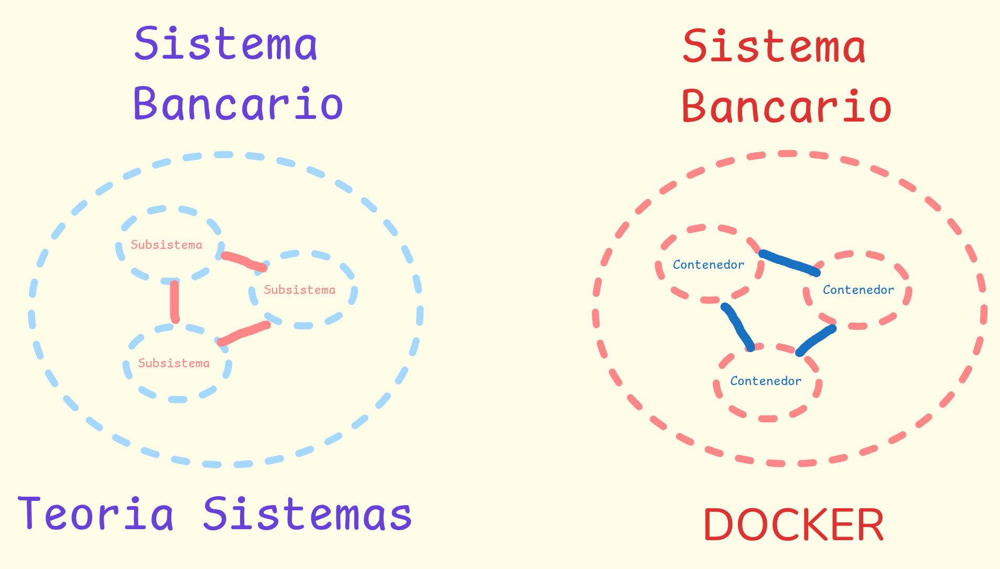

# Sistema Interbancario

## Instrucciones 

Tú primer proyecto de programación. Vas a crear un sistema bancario que puede realizar transacciones internas y a otros bancos simulando que están en redes separadas cuando en realidad están separadas a nivel de red por *Contenedores Docker*. Esto va a simular que cada banco está en un servidor diferente 




### Estructura Proyecto:
```
sistema_bancario/
├── app/
│   ├── __init__.py
│   ├── main.py                  # Punto de entrada de la API y configuración
│   ├── domain/                  # POO (sin librerías externas, sin SQL)
│   │   ├── __init__.py
│   │   ├── entities.py          # Clases: Cliente, Banco, Transaccion
│   │   └── accounts.py          # Clases: Cuenta (Base), CuentaAhorro, CuentaCorriente
│   ├── application/             # CAPA 2: Reglas del negocio bancario (logica)
│   │   ├── __init__.py
│   │   └── services.py          # Lógica de depósitos, retiros y transferencias
│   ├── infrastructure/          # Se comunica con otros sistemas
│   │   ├── __init__.py
│   │   ├── database.py          # Conexión SQLite y consultas SQL manuales
│   │   └── bank_client.py       # Comunicación HTTP con contenedores de otros bancos
│   └── presentation/            # Endpoints de la API
│       ├── __init__.py
│       └── routes.py            # Rutas HTTP (Login simple, cuentas, transferir)
├── frontend/                    # Vacío hasta que completes las fases de backend
│   
├── tests/                       # Reto Final
│   └── test_bank.py
├── .env                         # Variables de Entorno                 
├── .gitignore                   # Archivos a ignorar en un commit
├── Dockerfile                   # Archivo de construcción de contenedor de Bancos
├── docker-compose.yml           # Archivo que inicia los contenedores docker
├── requirements.txt             # Librerias de Python necesarias para el sistema
└── README.md
```

## Reglas

1. **Uso de Inteligencia Artificial:**

   - **PROHIBIDO** usar IA para generar código del backend o autocompletar funciones, todo el código debe ser escrito a mano. Solo puedes usar la IA para: preguntar por un concepto que no entiendes, pedir consejos o que te enseñe algo. No debes dejar que la IA escriba código por tí hasta que sepas a programar y entender lo que estás haciendo, esto sé hace con mínimo 3 proyectos ya desarrollados.

   - **PROHIBIDO** copiar y pegar un error en la IA de inmediato. Debes leer el _traceback_ (error en los logs), buscar en la documentación oficial e intentar resolverlo por tu cuenta. Solo tienes permiso de consultar un error con la IA si llevas **más de 1 hora cronometrada** atascado en exactamente el mismo fallo. Es recomendable que veas tu diagrama de flujo para identificar por qué está fallando tu sistema.

   - **PERMITIDO:** Usar la IA como un profesor (ej. _"¿Qué es el polimorfismo en Python?"_) y usarla como quieras en la última fase para construir el Frontend. En la fase del frontend puedes usar la IA para que programe todo el código ( !! SOLO EN ESTA FASE!! ), tú serás el encargado de diseñar la interfaz para que puedas explicarle bien a la IA lo que quieres hacer, y serás responsable de conectar manualmente el backend con el frontend.  

1. **Orden de Construcción:** No escribirás ni una sola línea de HTML, CSS o JavaScript[cite: 1] hasta que todo el Backend funcione al 100% y pueda probarse desde la documentación interactiva de la API (`/docs`).
2. **Flujo de Trabajo en Git:**
   - La rama `main` está bloqueada. Si intentas hacer `git push origin main`, el servidor te rechazará. Por lo que debes aplicar lo que te enseñé sobre las ramas en **Git**
   - Por cada fase o tarea, debes crear una rama nueva (`git checkout -b feature/nombre-de-tarea`).
   - Cuando termines una fase, sube tu rama a GitHub y abre un **Pull Request (PR)** para que yo revise tu código antes de fusionarlo con la rama Main. Aquí me aseguraré de corregirte en para que vayas mejorando. (Investiga y aprende como usar Git)

## Docker

En este proyecto usaras Docker para todo, es una buena práctica que es un poco díficil de entender al principio pero si aplicas la teoría de sistemas lo vas a entender muy rápido, es una buena práctica que se debe de implementar desde el día 1. Gracias a `docker-compose.yml`, tu código servirá como plantilla para levantar 2,3 o infinita cantidad de bancos al mismo tiempo sin tener que escribir código nuevo, solo toma el código que ya escribiste, defines sus variables únicas que la diferencia de otros bancos y ya la tienes corriendo en la computadora esperando conexiones, dejé un archivo `docker-compose.yml` donde corren 2 bancos simples que creé como base:

- **Banco Alfa (Código `0101`):** Disponible en `http://localhost:8001/docs`
- **Banco Beta (Código `0102`):** Disponible en `http://localhost:8002/docs`

Comandos básicos que debes dominar:

- Levantar los bancos: `docker compose up --build`
- Levantarlos en segundo plano: `docker compose up -d`
- Ver los registros/errores en vivo: `docker compose logs -f`
- Apagar los contenedores: `docker compose down`
- Cómo comunicarse con los contenedores en los puertos expuestos, en este caso el puerto expuesto del **Banco Alfa** es 8001.

## Investigar y Aprender antes de empezar a Crear

Antes de empezar a crear, investiga qué significan estos conceptos, solo debes de saber por encima que son, no hace falta que los domines al 100%, lo aprenderás sobre la marcha cuando los empieces a aplicar, un consejo que te doy es:
***Cuando investigues un concepto nuevo en programación, pregunta a la IA qué función cumple ese concepto o herramienta en la teoría de sistemas: ¿Es una frontera?, ¿Es parte del Entorno?, ¿Es un subsistema?... Esto te permite ver cómo usarlo eficientemente***

Para aprender estos conceptos te recomiendo que uses *Youtube*

- **POO:** Clase, Objeto, Instancia, Encapsulamiento (atributos privados/protegidos en Python y `@property`), Herencia (`super()`), Polimorfismo y Clases Abstractas (`abc`).
- **Arquitectura Limpia (Clean Architecture):** Separación de responsabilidades (Dominio, Aplicación, Infraestructura, Presentación).
- **Redes y APIs:** Protocolo HTTP, verbos (`GET`, `POST`), códigos de estado (`200`, `201`, `400`, `404`, `500`), formato JSON y comunicación entre contenedores Docker.
- **Bases de Datos:** Persistencia en SQLite, llaves primarias (`PRIMARY KEY`), llaves foráneas (`FOREIGN KEY`) y transacciones ACID.
- **Git:** Pull Requests, Ramas, Commits, Comandos Fundamentales...

## Fases de Desarrollo

### Fase 0: Crear Rama Git

Crea una rama en git antes de empezar a programar cualquier cosa y asegurate de entrar a esa rama 

### Fase 1: POO pura en `app/domain/`) (Estructura del de Sistema) 

Construye las clases que representan a un banco sin conectarte todavía a las bases de datos ni a internet.

- Crea las entidades `Cliente`, `Banco` y `Transaccion`.
- Crea la clase base `Cuenta` y sus clases hijas `CuentaAhorro` y `CuentaCorriente`.
- Implementa las validaciones de saldo, depósitos y retiros.

**Conceptos clave:**
POO (Herencia, Clases, Atributos y métodos)
Relación entre POO y Bases de Datos
Conceptos básicos de un sistema bancario
Preguntar a la IA y dibujar manualmente un sistema bancario simple como sistema


### Fase 2:  (Persistencia en `app/infrastructure/database.py`)

Si se apaga el contenedor Docker, los objetos en la memoria RAM desaparecen. Por eso se crean las bases de datos

- Diseña las tablas en SQLite para guardar clientes, cuentas e historial de movimientos.
- Conecta tu capa de aplicación (`app/application/services.py`) para que cada vez que se cree una cuenta o se mueva dinero en tus objetos, el cambio quede guardado en el archivo `.db`.

**Conceptos claves:**
Acumuladores en la Teoría General de Sistemas
Bases de datos como acumuladores
Importancia de Bases de datos
SQLite, entender arquitectura de bases de datos ( cliente/servidor )
Conexión Python-SQLite


### Fase 3: (API Local en `app/presentation/routes.py`) (Fronteras)

Abre tu banco al público usando FastAPI.

- Crea un endpoint de login sencillo para identificar al cliente.
- Crea endpoints para consultar saldo, ver historial de movimientos y hacer transferencias entre cuentas del **mismo banco**.

**Conceptos Claves:**
APIs en la Teoría General de Sistemas
FastAPI (El Papus)
Comunicación HTTP usando APIs, (Cómo se comunica todo en internet)
Comunicación entre contenedores Docker a través de APIs
Documentación automática de FastAPI (Swagger)
Buenas prácticas al momento de programar una API


### Fase 4: Comunicación entre Contenedores Docker

Haz que un cliente del `Banco Alfa` (puerto 8001) pueda enviarle dinero a un cliente del `Banco Beta` (puerto 8002).

- Define un código para los números de cuenta (ej. que los primeros 4 dígitos sean el código del banco: `0101-...` o `0102-...`).
- Si el banco detecta que la cuenta destino es de otro banco, debe descontar el dinero localmente y enviar una petición HTTP al contenedor del otro banco en su endpoint de recepción de transferencias.

**Conceptos clave:**
Comunicación entre contenedores
Pydantic
Transacciones bancarias
Transacciones ACID en SQL
Modelado de Datos


### Fase 5: Frontend con la Trinidad Web

Una vez que termines las Fases 1 a 4 y estén en *GitHub* (Osea que yo haya verificado que esté todo bien y apruebe los Pull Requests) , construye en la carpeta `frontend/` una página web en HTML, CSS y JS (aquí sí puedes usar la IA como te pegue la gana) para que el usuario inicie sesión, vea sus cuentas y envíe transferencias.


### Fase 6: Retos (Opcional)

Si terminar las 5 fases de desarrollo, puedes hacer uno de estos retos que pertenecen a fases más avanzadas 

- **Reto 1 - Pruebas Automatizadas:** Completa `tests/test_bank.py` usando `pytest` para verificar que nadie pueda retirar más dinero del que tiene ni transferir montos negativos.

- **Reto 2 - El Ataque de los Clones (Condición de Carrera):** _"Un cliente abre la página del banco en su celular y en su laptop al mismo tiempo. Tiene $100 en su cuenta y presiona 'Transferir $100' en ambos dispositivos en el mismo milisegundo. ¿Cómo evitas que el banco envíe $200?"_ _(Pista: Investiga qué es una **Race Condition** y cómo funcionan los bloqueos de base de datos o transacciones aisladas)._


# Para el Final (Después de que pases todas las fases)
## Acertijos de Desarrollo

Esto te ayuda a pensar como desarrollador, son acertijos que te voy a dejar que hice con ayuda de la IA para que pienses como resolverlos para no darte todo masticado, así empiezas a pensar como un desarrollador por tu cuenta. Ya vas a poder irlos entendiendo sobre la marcha e ir contestandolos.

1. **El Acertijo de la Bóveda Abierta:**
   _"Si cualquier visitante del banco puede meter la mano en la bóveda y escribir en un papel cuánto dinero tiene sin pasar por el cajero, el banco quebrará en cinco minutos."_
   _(Pista técnica: Investiga **Encapsulamiento** y el decorador `@property` en Python. El saldo de una cuenta jamás debe modificarse directamente desde fuera de la clase con `cuenta.saldo = 1000`, sino únicamente a través de métodos validados como `depositar()` y `retirar()`)._

2. **El Acertijo de los Gemelos con Reglas Distintas:**
   _"Dos hermanos nacen del mismo padre y ambos saben entregar dinero, pero uno te cobra un peaje cada vez que sacas billetes y el otro te exige dejar un monto mínimo intocable."_
   _(Pista técnica: Investiga **Herencia y Polimorfismo**. Tanto `CuentaAhorro` como `CuentaCorriente` heredan de `Cuenta`, pero cada una debe sobrescribir el método `retirar()` con sus propias reglas de negocio)._

3. **El Acertijo del Apagón a Mitad del Camino:**
   _"El cajero le resta $100 a Juan, pero justo antes de anotar los +$100 en la cuenta de María, se corta la electricidad en el edificio. Cuando vuelve la luz, los $100 desaparecieron del universo."_
   _(Pista técnica: Investiga **Atomicidad y Transacciones SQL (`COMMIT` y `ROLLBACK`)**. Una transferencia entre dos cuentas debe ejecutarse como una única transacción en la base de datos: o se guardan ambos cambios con éxito, o se deshace todo si ocurre una excepción)._

4. **El Acertijo del Mensajero entre Islas:**
   _"El Banco Alfa y el Banco Beta viven en islas vecinas dentro del mismo océano. No comparten el mismo libro contable, así que para enviarse dinero necesitan un mensajero que viaje de una isla a otra llevando un sobre sellado."_
   _(Pista técnica: Investiga cómo hacer peticiones HTTP desde Python usando la librería `httpx` o `requests`[cite: 1], y cómo funciona el DNS interno de Docker Compose para que un contenedor llame a `http://banco_beta:8000` sin usar `localhost`)._

